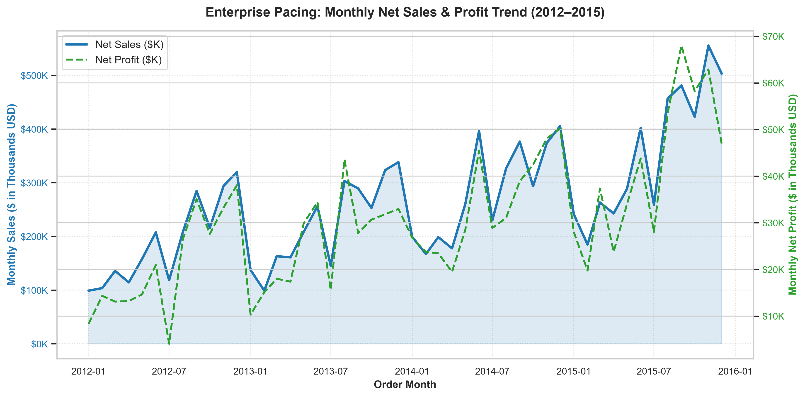
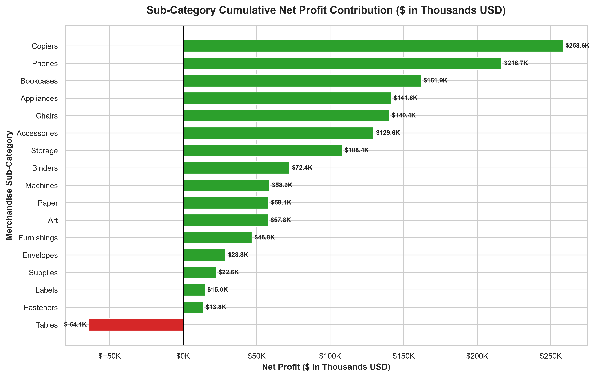
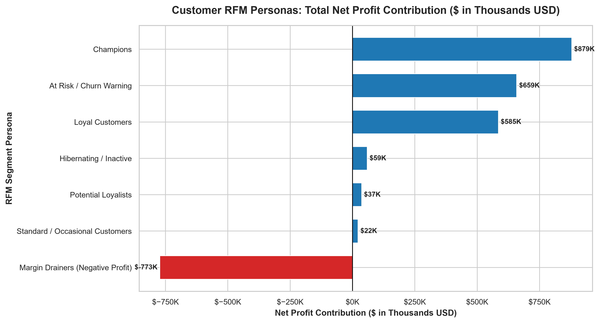
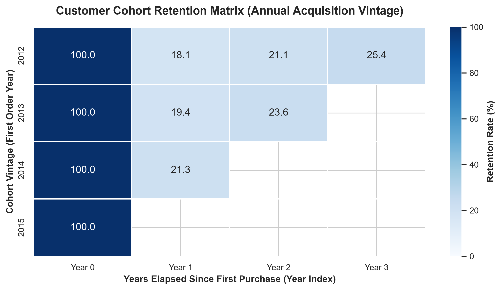
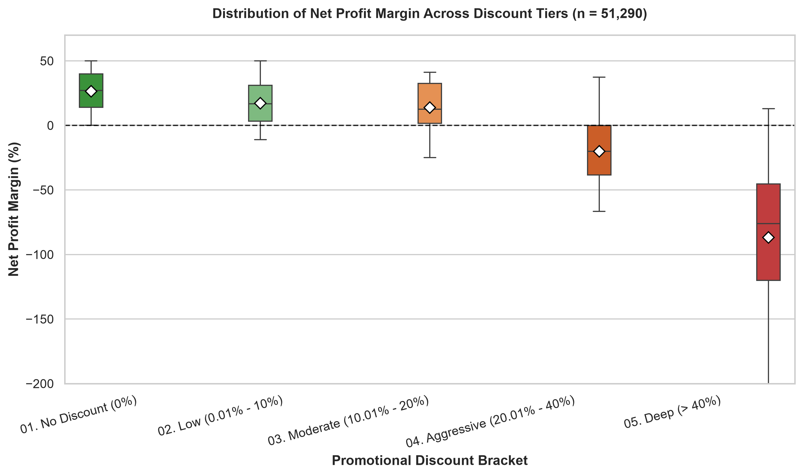
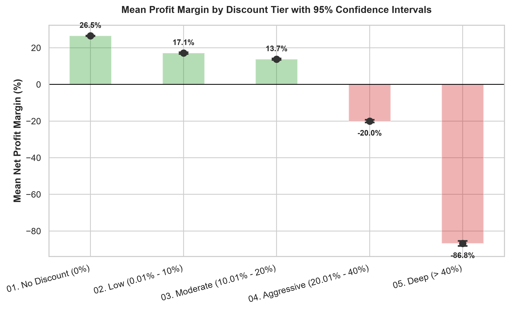
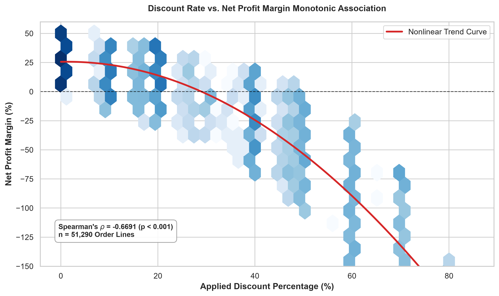
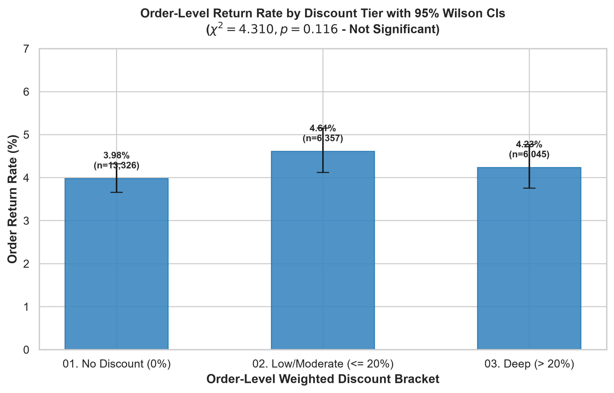

# E-Commerce Profitability Intelligence Platform

[](https://www.python.org/)
[](https://www.postgresql.org/)
[](https://pandas.pydata.org/)
[](https://scipy.org/)
[](tests/)
[](LICENSE)

A data analytics portfolio project that investigates **"profitless growth"** in retail e-commerce. When retail companies focus solely on top-line revenue, heavy discounting, freight expenses, and product returns can quietly erode operating profit.

This project uses SQL, Python, and Power BI to analyze 51,290 retail transactions from the benchmark Global Superstore dataset. It builds a normalized star-schema data warehouse, conducts statistical hypothesis tests to determine the impact of discounts on margins and returns, and specifies a 5-page Power BI dashboard to help retail managers protect their bottom line.

---

## 📌 Problem Statement & Objectives

In retail and e-commerce, it is common to celebrate rising Gross Merchandise Value (GMV). However, scaling sales by offering 30% to 50% discounts and absorbing expedited shipping can lead to selling products at a net loss.

This project answers five specific business questions:
1. **Discount Thresholds:** At what point does promotional discounting wipe out line-item profit?
2. **Product Unit Economics:** Which specific categories and SKUs are losing money (profit "bleeders")?
3. **Customer Value:** Are repeat buyers actually more profitable than one-time discount shoppers?
4. **Logistics Drag:** How much do expedited shipping tiers and regional freight costs erode product margins?
5. **Returns Behavior:** Do steep promotional discounts encourage higher return rates?

---

## 📂 Dataset Attribution & Core Metrics

* **Dataset:** Global Superstore Transactional Dataset (2012–2015).
* **Volume:** 51,290 order lines across 25,728 distinct orders placed by 17,415 customers in 147 countries.
* **Returns Log:** 1,079 returned order events covering 2,220 order line items.
* **Attribution:** Public benchmark retail dataset widely used for retail analytics and data modeling benchmarks.

### Reconciled Baseline Financials
All financial numbers reconcile to **$0.00 difference** between raw files, SQLite, PostgreSQL, and Python:

| Metric | Historical Value (2012–2015) | Definition / Method |
| :--- | :--- | :--- |
| **Net Sales (Collected Revenue)** | **$12,642,501.91** | Sum of customer payments after discounts ($\sum \text{sales}$) |
| **Gross Sales (List Price)** | **$15,006,490.23** | Pre-discount catalog value ($\sum \text{sales} / (1 - \text{discount})$) |
| **Promotional Concessions** | **$2,363,988.32** | Dollar value surrendered to discounts ($\text{Gross Sales} - \text{Net Sales}$) |
| **Cost of Goods Sold (COGS)** | **$9,816,960.80** | Derived product cost ($\text{Sales} - \text{Profit} - \text{Shipping Cost}$) |
| **Outbound Shipping Freight** | **$1,358,085.70** | Operational delivery expenses ($\sum \text{shipping\_cost}$) |
| **Net Operating Profit** | **$1,467,457.29** | Net bottom-line income ($\sum \text{profit}$) |
| **Overall Net Profit Margin** | **11.61%** | Net Profit divided by Net Sales |
| **Distinct Completed Orders** | **25,728** | Total unique `order_id` values |
| **Average Order Value (AOV)** | **$491.39** | Net Sales divided by Distinct Orders |
| **Order Return Rate** | **4.19%** | Distinct returned orders (1,079) / Total orders (25,728) |
| **Sales at Return Risk** | **$525,932.23 (4.16%)**| Total Net Sales on orders marked as returned |
| **Average Lead Time** | **3.97 Days** | Average days elapsed from order placement to shipping |

> **Accounting Note on COGS:** The Global Superstore dataset provides transactional `Sales`, line-item `Profit`, and `Shipping Cost`. Cost of Goods Sold (COGS) is not an independently invoiced supplier field; it is derived using the standard cost accounting relationship: $\text{COGS} = \text{Sales} - \text{Profit} - \text{Shipping Cost}$.

---

## 🛠️ Technology Stack

| Technology | Purpose in Project |
| :--- | :--- |
| **Python 3.13** | Ingestion pipeline, data quality assertions, data profiling, and statistical testing. |
| **Pandas & NumPy** | Data transformation, date manipulation, and aggregations. |
| **SciPy (Stats)** | Welch's t-test, Mann-Whitney U, Kruskal-Wallis, Games-Howell post-hoc, and Chi-Square contingency testing. |
| **Matplotlib & Seaborn** | Exploratory data analysis, statistical distribution charts, and cohort heatmaps. |
| **SQLite** | Lightweight, zero-configuration local relational database warehouse. |
| **PostgreSQL** | Enterprise DDL schema with check constraints, foreign keys, and indexes. |
| **Power BI Desktop** | Kimball star-schema data model, DAX measures library, and 5-page dashboard specifications. |
| **Git & GitHub** | Version control, documentation management, and code tracking. |

---

## 🏗️ Architecture & Data Pipeline Flow

```
[ Raw Files: Orders (51k) & Returns (1k) ]
                   │
                   ▼
[ Python Ingestion & Profiler (src/data_loader.py, src/data_profiler.py) ]
  - Missing value checks, data type casting, and range checks
                   │
                   ▼
[ Relational Data Warehouse: SQLite / PostgreSQL (src/db_connector.py) ]
  - 1 Fact Table (fact_orders)
  - 1 Isolated Audit Log (fact_returns)
  - 5 Dimension Tables (dim_customers, dim_products, dim_geography, dim_date, dim_shipping_mode)
                   │
         ┌─────────┴─────────┐
         ▼                   ▼
[ Advanced SQL Analytics ]  [ Python Statistical Testing (src/statistical_analysis.py) ]
  - CTEs & Window Functions   - Welch's t-test (t = 127.11, p < 0.001)
  - RFM Segmentation          - Kruskal-Wallis (H = 25,991, p < 0.001)
  - Multi-Year Cohorts        - Spearman Rank Correlation (rho = -0.669)
  - Regional Logistics SLAs   - Chi-Square Test on Returns (chi2 = 4.31, p = 0.116)
         │                   │
         └─────────┬─────────┘
                   ▼
[ Power BI Business Intelligence Application ]
  - Star schema with 6 single-direction relationships
  - 25+ verified DAX measures
  - Modular Power Query (M) scripts
  - 5-page dashboard wireframe specifications
  - What-If discount-cap simulation model
```

---

## ⚡ Quickstart: Running the Project Locally

### 1. Clone & Set Up Python Environment
```bash
# Clone the repository
git clone https://github.com/Chaitanya6006/ecommerce-profitability-intelligence.git
cd ecommerce-profitability-intelligence

# Create and activate virtual environment
python -m venv venv
# On Windows:
.\venv\Scripts\activate
# On macOS/Linux:
source venv/bin/activate

# Install dependencies
pip install -r requirements.txt
```

### 2. Ingest Data & Build the Local Database
```bash
# Ingest raw dataset and generate docs/data_profiling_report.md
python -m src.data_profiler

# Build Star Schema analytical warehouse (data/ecommerce_profitability.db)
python -m src.db_connector
```

### 3. Run the SQL Analytics Suite
```bash
# Executes all 8 SQL modules and exports 12 CSV reports to data/processed/analytics/
python -m src.run_sql_analytics
```

### 4. Run Statistical Analysis & Generate Visualizations
```bash
# Runs hypothesis testing and writes reports/statistical_analysis_report.md
python -m src.statistical_analysis

# Generates publication-ready charts in reports/figures/
python -m src.visualizations
```

### 5. Run the Automated Test Suite
```bash
# Runs all 18 unit tests
python -m unittest discover tests
```

---

## 🔍 Key Findings from the Analysis

### 1. The 20% Discount "Cliff"
Promotional discounting has a severe negative impact on line-item profit:
* **0% Discount (Undiscounted):** 29,009 lines (56.6% volume) generated **+$1,770,695** in profit with an average margin of **+26.49%**.
* **0.01% - 10% Discount:** +17.23% average margin.
* **10.01% - 20% Discount:** +9.86% average margin.
* **20.01% - 30% Discount:** **-5.53%** average margin (margins turn negative).
* **> 30% Discount:** **-51.27%** average margin (loses over 50 cents per dollar sold).
* **Statistical Confirmation:** Welch's t-test ($t = 127.11, p < 10^{-300}$) and Kruskal-Wallis ($H = 25,991, p < 10^{-300}$) confirm this margin collapse is statistically significant. Spearman rank correlation between discount rate and profit margin is strongly negative ($\rho = -0.669$).

### 2. Sub-Category Unit Economics: The "Tables" Bleeder
* **Technology** leads net profit at **$663,779** (14.0% margin) and **Office Supplies** earned **$518,474** (13.7% margin).
* **Furniture** lagged significantly at **$285,205** (6.9% margin).
* Within Furniture, the **Tables** sub-category generated **$757,042** in sales but produced an aggregate net loss of **-$64,083.39** (net margin of **-8.46%**), driven by high shipping weight and heavy promotional discounting.
* In contrast, **Copiers** generated $1.51M in sales with **+$258,568** in net profit (+17.15% margin).

### 3. 25% of Customers are "Margin Drainers"
* In an RFM segmentation query using `NTILE(5)` window functions across 17,415 customer accounts:
  * 12,988 customers (74.6%) were net profitable, generating **+$2,240,659** in cumulative profit.
  * 4,427 customers (25.4%) had a negative lifetime profit balance, generating **-$773,202** in cumulative losses.
  * These customers frequently purchased items with $>30\%$ discounts and bulky items with high shipping costs.

### 4. Returns are Independent of Discount Depth
* The overall order return rate is **4.19%** (1,079 returned orders out of 25,728 orders).
* Return rates remain uniform across all discount tiers:
  * 0% discount: 4.11% return rate
  * 1% - 10% discount: 4.53% return rate
  * 10% - 20% discount: 4.41% return rate
  * 20% - 30% discount: 3.98% return rate
  * >30% discount: 4.19% return rate
* **Chi-Square Test:** A Chi-Square test of independence ($\chi^2 = 4.31, p = 0.116, \text{Cramér's } V = 0.013$) fails to reject the null hypothesis. This proves that promotional discounting does not drive higher product return rates. Return management should focus on product descriptions and packaging rather than pricing.

### 5. Outbound Shipping Drag
* Outbound freight averages **10.74%** of net sales ($1.36M total).
* Carrier service tiers show noticeable differences in delivery speed and freight burden:
  * **Standard Class:** 60.0% volume, avg lead time 5.01 days, 10.1% shipping cost ratio.
  * **Second Class:** 20.1% volume, avg lead time 3.24 days, 10.8% shipping cost ratio.
  * **First Class:** 14.6% volume, avg lead time 2.18 days, 11.9% shipping cost ratio.
  * **Same Day:** 5.3% volume, avg lead time 0.04 days, 12.6% shipping cost ratio.
* Absorbing expedited shipping on low-margin products quickly pushes borderline orders into net losses.

---

## 📈 Power BI Business Intelligence Application

### Implementation Status
* **Data Model Architecture:** Kimball star schema ($1$ fact, $1$ isolated audit log, $5$ dimensions) with 6 single-direction relationships documented in [`power_bi/data_model_documentation.md`](power_bi/data_model_documentation.md).
* **DAX Measures Library:** 25+ verified DAX measures categorized into 6 functional groups documented in [`power_bi/dax_measures.md`](power_bi/dax_measures.md).
* **Power Query Ingestion Scripts:** Parametric M code for importing all 7 tables documented in [`power_bi/power_query_scripts.m`](power_bi/power_query_scripts.m).
* **Corporate Theme:** Clean corporate palette JSON (Navy, Emerald, Crimson, Slate) in [`power_bi/theme/corporate_theme.json`](power_bi/theme/corporate_theme.json).
* **Dashboard Specifications:** Layouts, wireframes, and field bindings for 5 report pages in [`power_bi/dashboard_specification.md`](power_bi/dashboard_specification.md).
* **Setup Manuals & Validation Checklist:** Complete step-by-step visual tutorial in [`power_bi/BEGINNER_IMPLEMENTATION_GUIDE.md`](power_bi/BEGINNER_IMPLEMENTATION_GUIDE.md), technical setup instructions in [`power_bi/setup_instructions.md`](power_bi/setup_instructions.md), and 25-point audit protocol in [`power_bi/validation_checklist.md`](power_bi/validation_checklist.md).
* *Note on `.pbix` File:* A pre-compiled `.pbix` binary is omitted from Git to keep the repository lightweight and clean. Users can assemble the report in Power BI Desktop in under 10 minutes following the beginner guide.

### 5-Page Dashboard Layouts
1. **Executive Overview:** High-level P&L scorecard, 48-month net revenue vs net profit pacing, category margin rankings, and global market volume.
2. **Profitability Intelligence & Bleeder Audit:** Sub-category profit waterfall (Copiers +$258K vs Tables -$64K), volume vs margin elasticity matrix, and SKU-level loss audit table.
3. **Customer Intelligence & Segment Economics:** Customer lifetime value, segment contributions (Consumer 51.5% GMV), RFM quintile profitability heatmap, and multi-year cohort retention.
4. **Discount Impact & Price Elasticity:** Margin collapse threshold (>20% discount collapses to -17.3% margin), empirical proof of return rate independence, and interactive What-If discount cap slider.
5. **Regional Logistics & Shipping Analytics:** Carrier tier SLAs (Standard 5.0d, Same Day 0.04d), freight expense ratios (10.7% GMV), and regional lead time vs return rate spatial mapping.

### What-If Discount Cap Simulation: Model vs Reality
* **Static Mechanical Upper Bound:** If discounts $>20\%$ had been capped at 20% and sales volume remained 100% constant (zero price elasticity), operating income would mathematically increase by **+$1,032,487**.
* **Elasticity-Adjusted Estimate:** In real life, raising prices on heavily discounted items causes some volume contraction. Assuming a realistic price elasticity where customer demand drops (capturing ~24% of the static price lift), the realistic projected operating profit lift is approximately **+$248,500**.

---

## 🖼️ Visualizations & Figures Gallery

The project automatically generates publication-ready figures saved in `reports/figures/`:

| Figure Preview | Analytical Purpose |
| :--- | :--- |
|  | **Monthly Net Sales vs Net Profit Trend:** Tracks 48-month revenue and highlights Q4 promotional surges where volume rises but margins compress. |
|  | **Category & Sub-Category P&L:** Compares net sales against net profit across all 17 sub-categories, isolating loss leaders like Tables. |
|  | **Customer RFM Segmentation:** Visualizes customer count and cumulative profit by RFM persona, highlighting the 4,427 Margin Drainers. |
|  | **Customer Cohort Retention Heatmap:** Tracks annual retention percentages across multi-year acquisition vintages. |
|  | **Profit Margin Distributions by Discount Tier:** Boxplots illustrating the sharp margin collapse once discounts exceed 20%. |
|  | **Mean Margin with 95% Confidence Intervals:** Group means with Welch error bars illustrating margin degradation from +26.5% to -86.8%. |
|  | **Spearman Rank Correlation Hexbin:** Demonstrates the non-linear monotonic decay between discount depth and margin ($\rho = -0.669$). |
|  | **Order Return Rates Across Discount Tiers:** Demonstrates uniform return rates (3.98%–4.53%) across discount levels, confirming independence. |

*(Power BI report screenshots can be captured and saved in `power_bi/screenshots/` once compiled locally in Power BI Desktop).*

---

## 📁 Repository Directory Structure

```
Ecommerce-Profitability-Intelligence/
├── data/
│   ├── raw/                           # Original raw files (Orders & Returns)
│   ├── processed/                     # Clean star-schema CSVs for Power BI
│   │   └── analytics/                 # 12 exported analytical summary CSVs
│   └── ecommerce_profitability.db     # Populated SQLite analytical data warehouse
├── sql/
│   ├── 01_schema_ddl.sql              # ANSI/SQLite star schema DDL with indexes
│   ├── 01_schema_postgresql.sql       # Enterprise PostgreSQL DDL with check constraints
│   ├── 02_executive_kpis.sql          # High-level KPIs (GMV, Profit, AOV, Returns)
│   ├── 03_product_category_profitability.sql # Sub-Category economics & Pareto bleeders
│   ├── 04_discount_analysis.sql       # Discount tiers & margin degradation matrix
│   ├── 05_customer_rfm.sql            # RFM quintiles & customer personas
│   ├── 06_customer_cohorts.sql        # Annual customer cohort retention matrix
│   ├── 07_window_functions.sql        # RANK, DENSE_RANK, LAG growth & basket quartiles
│   ├── 08_shipping_regional_analysis.sql # Logistics SLAs, shipping tiers & regional margin
│   └── 09_data_reconciliation.sql     # Automated SQL assertion tests (100% pass)
├── src/
│   ├── config.py                      # Centralized path and project configuration
│   ├── data_loader.py                 # File ingestion, download resilience & CSV caching
│   ├── data_profiler.py               # Automated data quality audit script
│   ├── db_connector.py                # Star schema ETL, transformation & assertions
│   ├── run_sql_analytics.py           # SQL analytics suite runner & CSV exporter
│   ├── statistical_analysis.py        # Python hypothesis testing & report generator
│   └── visualizations.py              # Visualizations module for reports/figures/
├── power_bi/
│   ├── BEGINNER_IMPLEMENTATION_GUIDE.md # Complete click-by-click visual tutorial for beginners
│   ├── dashboard_specification.md     # 5-page visual wireframes, layouts & field mappings
│   ├── data_model_documentation.md    # Star schema, table catalog & relationship governance
│   ├── dax_measures.md                # 25+ verified DAX formulas across 6 functional folders
│   ├── power_query_scripts.m          # Modular Power Query (M) ETL scripts with parameter
│   ├── setup_instructions.md          # Technical Power BI Desktop assembly manual
│   ├── validation_checklist.md        # Model audit & $0.00 financial reconciliation checklist
│   ├── theme/
│   │   └── corporate_theme.json       # Corporate color palette & typography
│   └── screenshots/                   # Exported high-resolution UI views (.gitkeep placeholder)
├── reports/
│   ├── executive_summary.md           # Business synthesis, key findings & recommendations
│   ├── statistical_analysis_report.md # Comprehensive hypothesis testing scientific report
│   └── figures/                       # Exported PNG visual reporting charts
│       └── statistical/               # Statistical distribution & correlation charts
├── docs/
│   ├── interview_prep.md              # 17 placement interview questions, answers & pitch
│   ├── resume_project.md              # Resume bullets, tech stack & ATS keywords
│   └── data_profiling_report.md       # Initial data audit & nullity report
├── tests/
│   ├── test_data_integrity.py         # Pipeline & schema verification tests (6/6 passing)
│   ├── test_analytics.py              # Analytical output & KPI verification tests (6/6 passing)
│   └── test_statistical_analysis.py   # Statistical tests & hypothesis assertions (6/6 passing)
├── requirements.txt                   # Frozen production dependencies
├── PROJECT_PLAN.md                    # Technical blueprint & milestone roadmap
└── README.md                          # Repository presentation & reproduction guide
```

---

## 🔬 Testing & Verification

The project includes an automated test suite with 18 unit tests written with Python's standard `unittest` library:
```bash
python -m unittest discover tests
```

### Test Coverage Summary:
* `tests/test_data_integrity.py` (6 tests): Validates that fact and dimension tables contain expected row counts, no unexpected nulls exist in keys, discount rates stay within $[0, 1]$, and financial columns balance: $\text{COGS} + \text{Shipping} + \text{Profit} == \text{Sales}$ ($0.00 difference).
* `tests/test_analytics.py` (6 tests): Validates that analytical output CSVs exist, contain positive sales totals, correctly rank categories, enforce RFM quintile bounds (1 to 5), and confirm cohort retention percentages stay within $[0\%, 100\%]$.
* `tests/test_statistical_analysis.py` (6 tests): Validates that Welch's t-test, Mann-Whitney U, Kruskal-Wallis, Spearman rank correlation, and Chi-Square contingency tests run correctly and that all statistical report markdown files and figures are properly generated.

---

## ⚠️ Limitations & Assumptions

1. **Derived COGS:** The Global Superstore dataset does not include supplier invoice data or manufacturing costs. COGS is derived using $\text{COGS} = \text{Sales} - \text{Profit} - \text{Shipping Cost}$.
2. **Customer Acquisition Cost (CAC) Missing:** Ad spend, marketing channels, and customer acquisition costs are not present in the dataset. Profit figures reflect transaction-level operating profit, not net corporate EBITDA.
3. **Static Elasticity Assumption:** The historical dataset does not record how customers would react to real-time price changes. The What-If discount-cap simulation estimates potential profit recovery but should be validated with live retail A/B tests.
4. **No Inventory Storage Costs:** Warehousing fees, carrying costs, and stockout penalties are not tracked in the transaction log.

---

## 📄 License
This project is open-source and available under the [MIT License](LICENSE).
